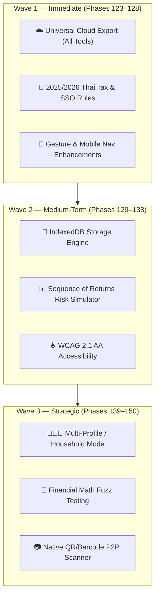

# Money Superapp — Next-Generation Improvement Plan (v2.6.0+)

> Strategic improvement roadmap following the 100% completion of the v2.5 foundation (Phases 85–122, v2.5.63). Covers 6 strategic pillars across Phases 123–150.

---

## Executive Summary

The previous improvement roadmap (`improvement-plan.md`) established an enterprise-grade architectural foundation:
- **Code Decomposition:** Decomposed monolithic files into 23 specialized engines in `js/engines/`.
- **Zero-Dependency Testing:** 670 automated tests (CDP headless browser journeys, visual regression, layout invariants, bilingual parity, type contracts).
- **Security & Quality:** Strict Content Security Policy (CSP), `safeHTML` tagged sanitizer, Lighthouse CI gate, 0 Biome warnings.
- **Data Mobility:** Google Drive export in Remaining Money, unified Bridge protocol.

**Every initiative in the original plan has been 100% delivered.**

This new roadmap (`plan.md`) charts the next horizon for **Money Superapp v2.6.0+**, focusing on:
1. **Universal Cloud & Storage Portability** (expanding Google Drive / Cloud export to all tools, IndexedDB tiering).
2. **2025/2026 Thai Tax & Regulatory Updates** (new ThaiESG rules, SSO wage ceiling transition, E-Receipt tracking).
3. **Advanced Visualizations & Financial Simulators** (Sequence of Returns Risk, dynamic inflation, interactive debt timelines).
4. **Mobile Native & PWA Experience** (gestures, App Badging, WCAG 2.1 AA accessibility).
5. **Multi-Profile & Household Finance** (Spouse/Family profiles, Freelance vs Salaried modes).
6. **Architectural Resilience & Fuzz Testing** (mathematical invariant testing, asset budget monitoring).

---

## Current Baseline (v2.5.63)

| Metric | Current State | Status |
|---|---|---|
| **Version** | v2.5.63 | ✅ Shipped |
| **Completed Phases** | 122 Phases | ✅ Clean history |
| **Test Suite** | 670 passing / 180 suites / 0 failing | ✅ 100% Green |
| **Lint Status** | 0 errors / 0 warnings (71 files) | ✅ Spotless |
| **Dependencies** | 0 runtime NPM deps (100% offline-first PWA) | ✅ ADR-001 Compliant |
| **Architecture** | 8 HTML tools, 23 domain engines, unified Bridge | ✅ ADR-002 Compliant |
| **Previous Plan (`improvement-plan.md`)** | 6 pillars, 18 initiatives | **100% Complete (0 remaining)** |

---

## Pillar 1 — Universal Cloud & Storage Portability

### 1.1 — Universal Cloud Export (Google Drive / Sheets / PDF across All Tools)
* **Context:** Phase 122 introduced Google Drive CSV/PDF export to `remaining-money.html`. Users need the same capability for:
  - **Net Worth & Financial Health Dossier** (`dashboard.html`): Export annual net worth evolution, asset allocation history, and health scores to Drive/Sheets.
  - **Tax E-Filing Dossier** (`tax-calculator-base.html`): Export itemized tax deduction worksheets and filing summaries as PDF/CSV.
  - **Debt Freedom Amortization Schedule** (`debt-calculator.html`): Export payoff timeline and payment milestones to Google Sheets.
  - **Rebalance Execution Order** (`rebalance.html`): Export buy/sell allocation orders for broker execution.
* **Effort:** Level 2 (2–3 phases) · **Risk:** Low · **Impact:** High

### 1.2 — IndexedDB Tiered Storage Engine
* **Context:** `localStorage` is restricted to ~5MB. Users importing multi-year bank statements or large payslip histories risk quota exhaustion.
* **Solution:** Create `js/engines/storage-db.js` providing an asynchronous IndexedDB wrapper (`MoneyApp.Storage`) with transparent fallback to `localStorage` for legacy browsers.
* **Effort:** Level 2 (2 phases) · **Risk:** Medium · **Impact:** High

### 1.3 — Native Barcode/QR Camera Scanner for P2P Device Migration
* **Context:** Phase 96 added QR-based payload chunking for offline sync, but required manual copy/paste or external readers.
* **Solution:** Integrate the browser-native `BarcodeDetector` API (with fallback file picker) to allow 1-second camera scanning of sync QR codes between mobile and desktop without server round-trips.
* **Effort:** Level 2 (2 phases) · **Risk:** Low · **Impact:** Medium

---

## Pillar 2 — 2025/2026 Thai Tax & Regulatory Updates

### 2.1 — ThaiESG (2024–2026) Holding & Cap Calibration
* **Context:** Thailand Revenue Department revised ThaiESG rules (holding period reduced from 8 years to 5 years, ceiling adjusted to 300,000 THB not exceeding 30% of taxable income).
* **Implementation:** Update `js/engines/thai-pit.js` and deduction modals in `tax-calculator-base.html` with real-time rule versioning (toggle between 2023, 2024, and 2025+ tax rules).
* **Effort:** Level 1 (1 phase) · **Risk:** Low · **Impact:** High

### 2.2 — Social Security Fund (SSF) Progressive Wage Ceiling
* **Context:** SSO wage ceiling transition roadmap (step-up from 15,000 THB to 17,500 THB and eventually 20,000 THB).
* **Implementation:** Add configurable/automatic SSO ceiling selection in `months-slips.html` based on the selected tax year.
* **Effort:** Level 1 (1 phase) · **Risk:** Low · **Impact:** Medium

### 2.3 — Easy E-Receipt & Tax Invoice Deduction Tracker
* **Context:** Periodic government tax stimulus programs ("Easy E-Receipt") provide up to 50,000 THB deductions.
* **Implementation:** Add an e-receipt tracking module with category tagging (VAT vs Non-VAT stores) and deduction ceiling meter.
* **Effort:** Level 2 (2 phases) · **Risk:** Low · **Impact:** High

---

## Pillar 3 — Advanced Financial Simulators & Visualizations

### 3.1 — Sequence of Returns Risk (SRR) & Dynamic Safe Withdrawal Rate (SWR)
* **Context:** Current Monte Carlo (`js/engines/monte-carlo.js`) simulates static wealth paths. In early retirement, market downturns drastically reduce portfolio longevity.
* **Implementation:** Add variable inflation shocks, Guyton-Klinger guardrails, and dynamic spending adjustments during bear markets.
* **Effort:** Level 2 (2 phases) · **Risk:** Low · **Impact:** High

### 3.2 — Interactive Cash Flow Waterfall & Category Filtering
* **Context:** The current SVG cashflow visualization in `remaining-money.html` is static.
* **Implementation:** Enable click-to-highlight on categories (Fixed vs Variable vs Savings), drill-down into sub-expenses, and interactive budget surplus allocation simulator.
* **Effort:** Level 2 (2 phases) · **Risk:** Low · **Impact:** Medium

### 3.3 — Visual Debt Payoff Timeline Comparator
* **Context:** `debt-calculator.html` compares Snowball vs Avalanche mathematically in tables.
* **Implementation:** Render an interactive dual-line SVG comparison chart showing principal remaining over time and visual markers for milestone payoff dates.
* **Effort:** Level 2 (1–2 phases) · **Risk:** Low · **Impact:** Medium

---

## Pillar 4 — Mobile & PWA Native Experience

### 4.1 — Gesture Navigation & Pull-to-Refresh Bridge Sync
* **Context:** On mobile, switching between tools requires tapping top/bottom nav buttons.
* **Implementation:** Add smooth horizontal swipe gesture handling on touch devices to cycle between tools, and pull-down to refresh cross-tool bridge data.
* **Effort:** Level 2 (2 phases) · **Risk:** Medium · **Impact:** High

### 4.2 — Web App Badging & Action Shortcuts
* **Context:** When installed as a PWA, users benefit from ambient status indicators.
* **Implementation:** Utilize the native `navigator.setAppBadge()` API to display remaining days until annual tax filing or monthly budget warnings.
* **Effort:** Level 1 (1 phase) · **Risk:** Low · **Impact:** Medium

### 4.3 — WCAG 2.1 AA Accessibility Audit & Live Regions
* **Context:** Financial applications must be accessible to users with vision impairments or relying on screen readers.
* **Implementation:** Add `aria-live="polite"` regions for calculated totals, verify 4.5:1 contrast ratios across both light and dark themes, and ensure 100% keyboard accessibility.
* **Effort:** Level 2 (2 phases) · **Risk:** Low · **Impact:** High

---

## Pillar 5 — Multi-Profile & Household Finance

### 5.1 — Multi-Profile Switching (Personal, Family/Spouse, Business/Freelance)
* **Context:** Many users manage both their personal salary finances and a freelance business or spouse's budget.
* **Implementation:** Add a Profile Switcher in the App Shell (`index.html`) that partitions `localStorage` / `IndexedDB` keys by active profile (`profile.default.*`, `profile.spouse.*`).
* **Effort:** Level 3 (3–4 phases) · **Risk:** Medium · **Impact:** Very High

### 5.2 — Joint Tax Filing & Spousal Exemption Optimizer
* **Context:** Thai PIT permits separate vs joint filing for married couples with different tax implications.
* **Implementation:** Simulate combined tax liability vs separate filing to identify optimal deduction distribution between spouses.
* **Effort:** Level 2 (2 phases) · **Risk:** Low · **Impact:** High

---

## Pillar 6 — Architectural Resilience & Fuzz Testing

### 6.1 — Financial Math Invariant & Fuzz Testing Suite
* **Context:** Financial engines must never produce `NaN`, `Infinity`, negative balances under valid constraints, or float rounding anomalies (e.g. `0.1 + 0.2 = 0.30000000000000004`).
* **Implementation:** Add `tests/fuzz-math.test.mjs` running 10,000 randomized permutations across PIT brackets, debt amortization, and rebalance calculations.
* **Effort:** Level 1 (1 phase) · **Risk:** Low · **Impact:** High

### 6.2 — Automated Asset Size & Zero-Dependency Budget Gate
* **Context:** Guarantee that the PWA remains hyper-lean and zero-dependency across future releases.
* **Implementation:** Add a CI step verifying total uncompressed JS/CSS payload stays under 350KB and zero runtime dependencies are introduced.
* **Effort:** Level 1 (1 phase) · **Risk:** Low · **Impact:** Medium

---

## Prioritized Implementation Roadmap

```mermaid
flowchart LR
    P123["Phase 123<br/>ThaiESG 2025/2026 & SSO Update"] --> P124["Phase 124<br/>Universal Cloud Export (Dashboard & Tax)"]
    P124 --> P125["Phase 125<br/>Universal Cloud Export (Debt & Rebalance)"]
    P125 --> P126["Phase 126<br/>Interactive Debt Payoff SVG Timeline"]
    P126 --> P127["Phase 127<br/>Math Invariant & Fuzz Testing Suite"]
    P127 --> P128["Phase 128<br/>Web App Badging & Gestures"]
    P128 --> P129["Phase 129<br/>IndexedDB Tiered Storage"]
    P129 --> P130["Phase 130<br/>Sequence of Returns Risk"]
    P130 --> P131["Phase 131<br/>WCAG 2.1 AA Accessibility"]
```

| Phase | Target Version | Scope & Deliverable | Complexity | Status |
|---|---|---|---|---|
| **Phase 123** | `v2.5.64` | ThaiESG 2024–2026 holding rules + SSO progressive ceiling update | Level 1 | ✅ **Shipped** (`362f895`) |
| **Phase 124** | `v2.5.65` | Universal Google Drive & Sheets export for Dashboard & Tax Dossier | Level 2 | ✅ **Shipped** (`0ddd75c`) |
| **Phase 125** | `v2.5.66` | Universal Google Drive & Sheets export for Debt & Rebalance tools | Level 2 | ✅ **Shipped** (`24b3d04`) |
| **Phase 126** | `v2.5.67` | Interactive Debt Payoff visual SVG comparison timeline | Level 2 | ✅ **Shipped** (`9841823`) |
| **Phase 127** | `v2.5.68` | Zero-dependency mathematical invariant & fuzz testing suite | Level 1 | ✅ **Shipped** (`2219891`) |
| **Phase 128** | `v2.5.69` | Mobile swipe gestures between tools + App Badging API | Level 2 | ✅ **Shipped** (`fee3b99`) |
| **Phase 129** | `v2.5.70` | IndexedDB tiered persistence engine (`js/engines/storage-db.js`) | Level 2 | ✅ **Shipped** (`7de6b9e`) |
| **Phase 130** | `v2.5.71` | Sequence of Returns Risk & Dynamic SWR retirement simulator | Level 2 | ✅ **Shipped** (`f5cb9c3`) |
| **Phase 131** | `v2.5.72` | WCAG 2.1 AA accessibility audit & live region announcements | Level 2 | ✅ **Shipped** (`0775667`) |
| **Phase 132** | `v2.5.73` | Mobile Settings modal viewport overflow & scroll trapping fix | Level 1 | ✅ **Shipped** (`a5dbdd8`) |
| **Phase 133** | `v2.5.74` | Rebalance quick-apply suggested top-up with budget deduction | Level 2 | ✅ **Shipped** (`86a56e6`) |
| **Phase 134** | `v2.5.75` | Automated Asset Size & Zero-Dependency Budget Gate (`test:budget`) | Level 1 | ✅ **Shipped** (`315eed6`) |
| **Phase 135** | `v2.5.76` | Easy E-Receipt & Tax Invoice Deduction Tracker (Pillar 2.3) | Level 2 | ✅ **Shipped** |
| **Phase 136** | `v2.5.77` | Interactive Cash Flow Waterfall & Category Filtering (Pillar 3.2) | Level 2 | ⏳ Planned |
| **Phase 137** | `v2.5.78` | Native Barcode / QR Camera Scanner for P2P Sync (Pillar 1.3) | Level 2 | ⏳ Planned |
| **Phase 138** | `v2.5.79` | Joint Tax Filing & Spousal Exemption Optimizer (Pillar 5.2) | Level 2 | ⏳ Planned |
| **Phase 139** | `v2.6.0`  | Multi-profile partition architecture (Personal / Family / Freelance) | Level 3 | ⏳ Planned |

---

## Status Summary

- **Previous Plan (`improvement-plan.md`):** **0 items left** (100% completed up through v2.5.63).
- **Completed in this Session:** **Phases 123–131 (v2.5.64 – v2.5.72)** — 9 phases shipped & pushed.
- **Remaining in Plan (`plan.md`):** **1 phase left** (Phase 132, targeting v2.6.0).
